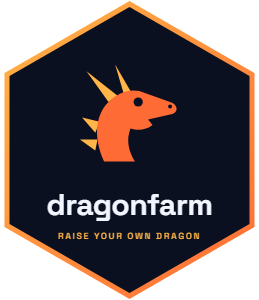

# dragonfarm 

[](https://CRAN.R-project.org/package=dragonfarm)
[](https://github.com/tejas4patel/dragon-farm/actions/workflows/R-CMD-check.yaml)
[](https://dragonfarm.dev)
[](https://colab.research.google.com/github/tejas4patel/dragon-farm/blob/main/inst/remote/dragonfarm_remote.ipynb)


**Fine-tune a language model on your own documents, from R.** Drop in PDFs,
Word files, web pages, or spreadsheets and ask them questions: answers come
back with cited sources before anything is trained. Then have a model write
training questions from the documents, review them, and fine-tune. A 7B model
trains in 4-bit on an 8 GB laptop GPU; small models train in minutes and suit
fixed formats such as JSON extraction. You get back an adapter or a merged
model that loads with plain Hugging Face `transformers`. Training runs in a
background Python process that the package sets up for you, on your own GPU
or on a free cloud one.


The app opens on documents and walks through the same six steps as the GIF:

1. **Documents**: drop in PDFs, Word files, HTML, Markdown, text, or
   spreadsheets, or add web pages. They are read, chunked, and indexed.
2. **Ask**: ask a question and get an answer with numbered sources. Nothing
   is trained yet; for many uses this is already enough.
3. **Teach**: a model writes questions and answers from each chunk, filters
   flag the weak ones, and you tick what to keep. Expect to keep about half.
4. **Train**: pick a base model, set a few numbers, press Start training (or
   send the run to a cloud GPU). Each prompt carries the retrieved excerpts.
5. **Monitor**: watch the loss curve; the panel also shows the R code that
   reproduces the run.
6. **Try it**: compare the fine-tuned model with the base model, both
   answering from your documents; then chat, judge, merge, or publish.

Already have a table of prompts and replies? One link switches the app to
the table route: load the table, drag its columns into Prompt and Response
slots, and carry on from Model.

## Install

```r
# The current version, with documents and the new app, as a ready-built package:
install.packages("dragonfarm", repos = c("https://tejas4patel.r-universe.dev", "https://cloud.r-project.org"))

# or the CRAN release: install.packages("dragonfarm")
library(dragonfarm)
dragon_check()                   # first run builds the Python environment: 2 to 3 GB
```

Or build it from GitHub with `pak::pak("tejas4patel/dragon-farm")`. Then open the
app with `dragon_app()`.

## Start with documents

You do not need a table of prompts and replies. Drop in documents, ask them
questions with cited sources, have a model write training questions from
them, review those, and fine-tune with the retrieved excerpts in every
prompt. In the app this is the Documents tab, the first one; in code:

```r
docs <- dragon_documents(c("policies/", "https://example.com/help"), name = "support")
dragon_ask(docs, "How long is the return window?")   # answer with [1] [2] footnotes, no training

qa <- dragon_questions(docs)        # questions and answers per chunk, filtered, every one kept with a reason
dragon_questions_save(qa)           # after you have looked at them
run <- dragon_train(dragon_questions_dataset(qa, docs), "Qwen/Qwen2.5-7B-Instruct",
                    hardware = dragon_hardware(load_in_4bit = TRUE),   # QLoRA: fits an 8 GB GPU
                    args = dragon_train_args(max_seq_len = 1536, gradient_checkpointing = TRUE),
                    wait = TRUE)                     # about 4 hours for 600 pairs on a laptop RTX 4060
dragon_chat(run, documents = docs)$say("A customer wants to return an opened device.")
```

Retrieval does most of the work and a bigger answering model helps more
than training does, so the default is to answer first and train second. The
numbers behind that, and what to expect from each model size, are in
[From your documents to your model](https://dragonfarm.dev/articles/documents.html).

## The same thing in code

The table route, for data that already comes as prompt and response rows:

```r
library(dragonfarm)
options(dragonfarm.runs_dir = "~/dragonfarm_runs")   # keep runs after R closes

run <- dragon_dataset(dragon_example_data()) |>
  dragon_map(prompt = "{subject}\n\n{body}", response = "reply") |>
  dragon_train("Qwen/Qwen2.5-0.5B-Instruct", wait = TRUE)

dragon_generate(run, "My thermostat keeps dropping off Wi-Fi.")
dragon_merge(run, "models/support-0.5b")
```

Runs live on disk, so you can close R and come back with
`dragon_run("~/dragonfarm_runs/<run id>")`, then `dragon_status()`,
`dragon_wait()`, `dragon_cancel()`, or `dragon_resume()`. By default a run goes
under a temporary folder that disappears when R closes, which is why the
example sets `dragonfarm.runs_dir` first (see `?dragon_runs_dir`).

## Before and after

`Qwen/Qwen2.5-0.5B-Instruct`, before and after fine-tuning on 190 of the
package's example support tickets (training takes about 2 to 4 minutes on a
laptop RTX 4060 and about 4 minutes on a free Colab T4, after the one-time
setup). This ticket was not in the training data; it is the median of the 10
held-out tickets by word overlap with the reference reply. Temperature 0:

> **Ticket:** Lumen bulb pack arrived damaged. Opened my Lumen bulb pack
> today and the casing is split. The packaging looked fine from the outside
> so it must have happened before shipping.

> **Base model:** I'm sorry to hear that your Lumen bulb pack has been
> damaged. It's important to take any damage seriously and report it to the
> manufacturer or seller as soon as possible. Here are some steps you can
> follow: 1. **Contact the Manufacturer**: Reach out to the company that sold
> you the Lumen bulb pack. They may be able to provide a replacement or offer
> a repair service. 2. **Report the Damage**: ... (shortened)

> **After fine-tuning:** I'm sorry your Lumen bulb pack arrived damaged. We
> will replace it at no cost. Please reply with a photo of the damage and one
> of the shipping label so we can file the carrier claim on our side. As soon
> as we have those, we ship a replacement Lumen bulb pack with a prepaid
> return label for the damaged unit. Usually a business day after the return
> is scanned in.

The policy and tone are right, but the last sentence mixes in a detail from
another ticket type (the real policy is two business days). That is typical of
small models, and a reason to review outputs before relying on them. The
example tickets are also synthetic and built from templates, so this shows a
model picking up a house style, not open-ended reliability. Measure on your own
data.

A larger model fixes most of this, and an 8 GB card is enough for one.
`Qwen/Qwen2.5-7B-Instruct` loaded in 4-bit (`dragon_hardware(load_in_4bit =
TRUE)`, QLoRA) trained three epochs on the same tickets in about 22 minutes on
the RTX 4060 and, on held-out tickets, reproduced every policy the 0.5B had got
wrong or blended, including the two-business-day detail above. The numbers and
settings are in [From your documents to your
model](https://dragonfarm.dev/articles/documents.html).

## Go further

| I want to | Read |
|---|---|
| Go from documents to a model | [From your documents to your model](https://dragonfarm.dev/articles/documents.html) |
| Pick a model size for my task and GPU | [Choosing a model size](https://dragonfarm.dev/articles/model-sizes.html) |
| Walk through the whole workflow | [Quickstart](https://dragonfarm.dev/articles/quickstart.html) |
| Use the app, or run it for other people | [The dragon-farm app](https://dragonfarm.dev/articles/shiny-app.html) |
| Train without a local GPU | [No GPU? Train in the cloud](https://dragonfarm.dev/articles/cloud-gpu.html) |
| Improve a model with judges, preference pairs, DPO | [Fine-tune, judge, prefer, repeat](https://dragonfarm.dev/articles/post-training-loop.html) |
| Train on rewards I can check (GRPO) | [Reinforcement learning](https://dragonfarm.dev/articles/reinforcement-learning.html) |
| Chat with a run and collect feedback | [Talk to it, anywhere it runs](https://dragonfarm.dev/articles/chat-and-feedback.html) |
| Measure whether it helped | [Metrics, judges, and comparisons](https://dragonfarm.dev/articles/evaluate.html) |
| Look up models, run files, and settings | [Requirements, models, and settings](https://dragonfarm.dev/articles/under-the-hood.html) |

## Requirements

R 4.1 or newer and about 3 GB of disk for the Python environment, which the
package sets up on first use. An NVIDIA GPU with 8 GB or more trains and runs
a 7B model in 4-bit (4-bit loading needs NVIDIA). Apple Silicon and smaller
GPUs train smaller models, and the smallest also run on a CPU. `dragon_check()` reports what it
found and how to fix it. Driver versions, GPU memory per model, and
environment variables are in
[Requirements, models, and settings](https://dragonfarm.dev/articles/under-the-hood.html).

## License

MIT. See [LICENSE.md](LICENSE.md).
